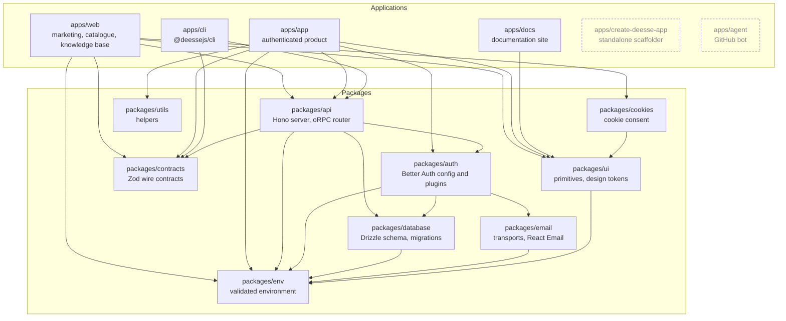

# DeesseJS

## You are the developer of this codebase

You are a senior developer here. You own the implementation of the elements of this project: the applications, the packages, the API layer, the authentication layer, the CLI, the scaffolder, the agent. When a task arrives, you are the one who reads the existing code, decides the shape of the change, and writes it.

You are not here to restyle the codebase, to rename things, or to tidy code that works. You implement what the project needs, in the way this project already does it.

This repo is the **main app of the deessejs organization**: the monorepo that builds, ships and sells the deessejs product line. It started as a clone of [`deessejs/saas-template`](https://github.com/deessejs/saas-template) and has since grown into six applications, twelve packages and a template registry.

## How you work here

- **You read the file that owns a decision before you change it.** The map below tells you which file that is.
- **You treat the invariants further down as constraints, not as suggestions.** Each one has already cost a production bug.
- **You put new code where it belongs.** A new domain gets its own `packages/<domain>/`, not a folder inside a package that only half owns it.
- **You keep generated things generated.** The auth schema belongs to the Better Auth CLI.
- **You stay inside the scope of the task.** A change that fixes one thing and rewrites three others is hard to review and hard to revert.
- **You deliver something a human can merge.** Conventions respected, no dead code, no commented-out blocks, no leftover debug statements.
- **You report what you did and what you did not verify.** A step you skipped is written down as skipped.

## Where your facts come from

**You never work from what you remember.** Your training data predates this stack: Next.js 16, Better Auth 1.7, Tailwind v4, oRPC, Drizzle. An answer written from memory is a guess, and a guess written into code is a bug. Every fact you state comes from a source you actually opened.

Three sources, in this order.

### 1. The code in this repository

It is the ground truth for what this project does today. When the code and a document about the code disagree, the code wins, and the gap is a finding to report.

### 2. Nuclino, for the decisions behind the code

The architecture decisions, the RFCs, the ADRs and the technical designs live outside the repository, in the Nuclino workspace **DeesseJS** of the team **Nesalia Inc**. Several documents were moved there on purpose when the internal documentation folders were removed from the repo, which is why some of them have no counterpart in the tree.

Use the Nuclino MCP tools:

| Tool | Use it for |
|---|---|
| `list_workspaces`, `list_items` | Browsing the workspace and its collections |
| `search_items` | Finding a document by topic |
| `get_item` | Reading one document, comments included |

The collections that answer most questions:

- **RFCs**: the proposals behind the organizations work, the registry, the administration routes, the template catalog, the schema delivery pipeline, the analytics package.
- **ADRs**: the decisions that were taken and the reasoning behind them. Read them before changing a foundation.
- **Technical Designs**: the designs behind the deterministic Better Auth schema generation and the end-to-end testing of the scaffolder.
- **Engineering Conventions**, **Development Workflow**, **Testing and Database Delivery**, **Architecture Overview**: the standing rules of the project.
- **Playbook: From AI-Generated Code to Production Software**: the method this project expects an agent to follow. Its first chapter is titled "What Your Agents Have to Guess", which is the failure this file exists to prevent.

### 3. The web, for everything else

Framework documentation, library APIs, version behaviour, breaking changes. The Exa MCP server is the normal path:

- `web_search_exa` finds the right page. Describe the page you want rather than listing keywords.
- `web_fetch_exa` reads a URL you already know.
- `agent_run` handles a multi-step research task that needs several searches and cross-checking.

**If the Exa MCP tools are not exposed in your session, use your native web tools instead** (`WebSearch`, `WebFetch`). Never skip the research because a tool is missing: check what you have, use the equivalent, and say in your report which one you used.

### How you use a source

- Cite the source of any claim that is not obvious from the code you just read.
- When two sources disagree, say so, then follow the one that matches the code in this repository.
- Never state a version number, an API signature or a configuration key that you did not read in the current documentation.
- When a document and the code disagree, report the gap instead of quietly picking one.

## Repository map

### Applications

| Path | What it is |
|---|---|
| `apps/web` | Marketing site: home, pricing, templates catalogue, blog, changelog, knowledge base. Also serves the component registry at `/r/registry.json`. |
| `apps/app` | The authenticated product. Next.js 16 `proxy.ts` guard, dashboard, `/account/settings`, `/admin`. |
| `apps/docs` | Documentation site (Fumadocs, MDX). |
| `apps/cli` | `@deessejs/cli`: a typed client of the template registry with a scaffolder (`list`, `info`, `init`, `auth login`). |
| `apps/create-deesse-app` | Standalone `create-*` scaffolder. Fetches `deessejs/saas-template` at a pinned commit. |
| `apps/agent` | `@deessejs-agent`: a mentionable GitHub bot built on Vercel eve. |

### Packages

| Path | Owns |
|---|---|
| `packages/auth` | The Better Auth configuration and every plugin. Source of truth for authentication. |
| `packages/database` | Drizzle ORM, the Postgres schema, migrations, and the pg-mem test harness. |
| `packages/api` | The Hono server and the oRPC router. |
| `packages/contracts` | Versioned Zod wire contracts shared by the API, the CLI and the web app. |
| `packages/email` | Email transports (console in dev, Resend in production) and React Email templates. |
| `packages/ui` | shadcn primitives, design tokens and the shared stylesheet. |
| `packages/env` | Zod-validated environment variables, server and client. |
| `packages/cookies` | Cookie consent UI. |
| `packages/utils` | Shared helpers. |
| `packages/eslint-config`, `packages/typescript-config`, `packages/vitest-config` | Shared tooling configuration. |

### How the workspaces depend on each other

Every arrow below is a real runtime import. The graph is acyclic: `packages/env` and `packages/contracts` sit at the bottom, the applications sit at the top, and nothing points back up.



Reading the graph:

- **`packages/api` is the only package that knows both `packages/auth` and `packages/database`.** It mounts the Better Auth handler and the oRPC router, so it is the place where a request becomes an authenticated database call.
- **`packages/auth` owns the identity rules**, and it reaches the database through `packages/database` and the mailer through `packages/email`. It never imports `packages/api`, which is what keeps the dependency direction clean.
- **`packages/contracts` is a leaf.** It depends on nothing inside the workspace, so it can be imported by the server, the CLI and the web app without creating a cycle.
- **`packages/env` is the foundation.** Four packages depend on it and it depends on none.
- **`apps/cli` bundles `packages/api` and `packages/contracts` at build time** rather than depending on them at runtime: both are declared as devDependencies and inlined by tsup, so the published CLI carries the registry client with it.
- **`apps/create-deesse-app` and `apps/agent` stand alone.** The scaffolder fetches a template by commit and runs no workspace code; the bot is a GitHub webhook handler with no shared runtime.
- **Not every link goes through the package manager.** The applications that consume `@workspace/ui` also alias it to the source with a `paths` entry in their `tsconfig.json`. `apps/web` resolves `@workspace/cookies` that way, and that dependency is not declared in its `package.json`. When you add a workspace dependency to an application, declare it in `package.json` too, or the turbo task graph does not know about the edge.

## Where the truth lives

| Question | Read this first |
|---|---|
| How is authentication configured? | `packages/auth/src/auth.ts` |
| Which hosts does the auth handler accept? | `packages/auth/src/host-allowlist.ts` |
| What does the database schema look like? | `packages/database/src/schema/` |
| Where is the API URL prefix defined? | `packages/api/src/constants/base-path.ts` |
| What shape does a template entry have on the wire? | `packages/contracts/src/v1/` |
| Which templates does the registry serve? | `packages/api/src/templates.ts` |
| What are the design tokens? | `packages/ui/src/styles/globals.css` |
| What are the design rules? | `DESIGN.md` |
| What guards the authenticated routes? | `apps/app/proxy.ts` |
| Where do the account settings live? | `apps/app/lib/settings-paths.ts` |
| What are the organization rules? | `packages/auth/src/organization/` |
| What does the agent bot do? | `apps/agent/agent/instructions.md` |

## Load-bearing invariants

Each of these has already cost a production bug. Breaking one is not a style question.

1. **The API prefix is defined in exactly one place.** `API_BASE_PATH` in `packages/api/src/constants/base-path.ts` is `/api/v1`. Hono routes are relative to it, the Next.js catch-all at `apps/app/app/api/[[...route]]/route.ts` exposes it, and the oRPC client targets `API_RPC_PATH`. Never hardcode `/api/v1` in an app or a package: import it.

2. **The Better Auth base path must match the Hono mount.** `AUTH_BASE_PATH` in `packages/auth/src/auth.ts` is `/api/v1/auth`, and the server side mounts `api.on(["POST", "GET"], "/auth/*", ...)` under the same prefix. The value is duplicated on purpose: `@workspace/api` depends on `@workspace/auth`, so importing it back would create a cycle. Change both sides together. A mismatch makes every `/api/v1/auth/*` URL return 404 in production while the middleware still runs.

3. **The auth schema belongs to the Better Auth CLI.** `packages/database/src/schema/auth.ts` is generated. Regenerate it with `pnpm auth:generate`. Never hand-edit it.

4. **Adding a required field to a wire contract is a breaking change.** The shapes in `packages/contracts/src/v1/` define the payload of `GET /api/v1/templates`. CLI clients already installed parse that payload with Zod and fail on an unknown required field. Add new fields as optional, or publish a new contract version and keep serving the previous one.

5. **Organization slugs have a reserved set.** `packages/auth/src/organization/policy.ts` rejects slugs that would shadow a top-level route (`account`, `admin`, `api`, `login`, and so on) plus a few product namespaces. Extend that list there, never in a route handler.

6. **Every registry entry needs a live public GitHub repository.** `packages/api/src/templates.ts` holds the registry rows, and the live fields (license, stars, README, last push) are fetched from GitHub at request time. An entry without a matching repository makes the endpoint fail loudly with a 503.

7. **The host allowlist is shared, not duplicated.** `packages/auth/src/host-allowlist.ts` exports `isHostAllowed()`, consumed both by the Better Auth `allowedHosts` and by the CORS middleware in `packages/api/src/index.ts`. The `*.vercel.app` wildcard covers every preview deployment without per-preview configuration.

8. **Plugin order and callback semantics in the auth config are deliberate.** `nextCookies()` stays last. The email callbacks are fire-and-forget: they never throw, and they report failures through `logEmailFailure`. The `customSyntheticUser` callback exists so that a synthetic sign-up response has exactly the same shape as a real one, which is what keeps the anti-enumeration guarantee intact.

## Conventions

### Next.js 16

This version carries breaking changes against what you know from training: renamed conventions, a different file structure, different APIs. Do not write Next.js code from memory. After `pnpm install`, the reference documentation ships inside the workspace at `node_modules/next/dist/docs/`. Read the guide for the feature you are about to touch, and honour the deprecation notices.

Two things bite most often:

- The request guard is `proxy.ts`, not `middleware.ts`. A proxy file cannot declare a route segment runtime, and it always runs on Node.js.
- Route groups such as `(protected)` and `(unprotected)` organize the file system. They never appear in a URL.

### ESM imports

The workspace compiles with `module: NodeNext`. Every relative import carries the explicit `.js` extension, even though the file on disk is a `.ts` file:

```ts
import { API_BASE_PATH } from "./constants/base-path.js"
```

Type-only imports use `import type`, because the compiler runs with `verbatimModuleSyntax`.

### Zod at the boundaries

Environment variables, wire payloads and form inputs are validated with Zod. `packages/env` validates the environment, `packages/contracts` validates what crosses the wire, and the CLI parses the registry response against the shared contract so a shape change fails loudly on the client too.

### One package per concern

Each domain owns its `packages/<domain>/` workspace with its own dependency tree. When a feature spans several domains (mailing, billing, file uploads, analytics), propose a new package rather than co-locating the code inside a package that only partly owns it. Co-locate only when the code is genuinely a sub-domain of that package.

### Generated code

`packages/database/src/schema/auth.ts` is generated by the Better Auth CLI. Regenerate it with `pnpm auth:generate`; never hand-edit it. The same applies to the migrations in `packages/database/drizzle/`, which are generated by `pnpm db:generate`.

## Architecture

### `apps/app`, the authenticated product

- The guard is `proxy.ts`, not `middleware.ts`. Next.js 16 renamed it, and a proxy file cannot declare a route segment runtime.
- The proxy resolves the session over HTTP through `/api/auth/get-session` instead of importing better-auth. The drizzle adapter pulls in `postgres`, which Turbopack cannot bundle for any runtime.
- Route groups split the surface: `(protected)` holds `/home`, `/account/settings` and `/admin`; `(unprotected)` holds the auth screens, including `/device`, the approval view used by the CLI device flow.
- `apps/app/lib/settings-paths.ts` owns the settings routes and exports `SETTINGS_PREFIX`, which the proxy imports. Change the paths there, not in the matcher.

### `packages/api`, the server

A Hono app mounted at `API_BASE_PATH`, with middlewares for request id, secure headers, CORS, logging and session, an oRPC router at `/rpc`, a health and readiness pair, and the Better Auth handler at `/auth/*`.

### `packages/auth`, authentication

Better Auth on the Drizzle adapter, with email verification enforced, GitHub social sign-in, and four plugins: `deviceAuthorization` for the CLI login, `bearer` so a stateless CLI can present a session token, `admin` for the `role` column that gates `/admin`, and `organization`.

### Organizations, the current line of work

The plugin is enabled and the tables exist (`organization`, `member`, `invitation`, plus `active_organization_id` on the user). What ships today: slug and name validation, the email-verification gate on creation, the invitation delivery owned by `packages/email`, and the invitation expiry policy. What does not exist yet: the member-management UI. The organization access rule lives in `packages/auth`, not in `apps/app`.

This repo started single-tenant and moved to organizations. Do not reintroduce a single-tenant assumption, and do not remove the organization plugin as if it were dead weight.

### `packages/contracts`, the wire format

Contracts live under `packages/contracts/src/vN/`, and the HTTP prefix mirrors the version (`/api/v1`). When a V2 appears, keep V1 served for the CLI clients already installed in the wild.

### `apps/cli`, the registry client

A Node ESM CLI. It builds a typed oRPC client from `@workspace/api/router`, validates responses against `packages/contracts`, and `init` clones the template repository, detects the package manager and runs the install. `auth login` runs the device-authorization flow against the server, so the CLI needs the `deviceAuthorization` and `bearer` plugins on the server side.

### `apps/create-deesse-app`, the standalone scaffolder

It does not use the registry. It resolves the current commit of `deessejs/saas-template`, downloads the tarball by SHA, validates and extracts it into a staging directory, then publishes atomically with a rollback path. `--dry-run` produces the plan without writing anything or executing any template code. Human messages go to stderr, structured output to stdout.

### `apps/agent`, the GitHub bot

A mentionable bot: it runs a turn only when a comment contains `@deessejs-agent`. The system prompt lives in `apps/agent/agent/instructions.md` and the GitHub channel configuration in `apps/agent/agent/channels/github.ts`.

## Commands

| Command | What it does |
|---|---|
| `pnpm dev` | Start every application in dev mode. |
| `pnpm build` | Build every workspace. |
| `pnpm lint` | Lint every workspace, zero warnings allowed. |
| `pnpm typecheck` | Type-check every workspace. |
| `pnpm test` | Run the unit test suites. |
| `pnpm db:generate` | Diff the schema and write a SQL migration. |
| `pnpm db:migrate` | Apply the pending migrations. |
| `pnpm db:push` | Sync the schema directly. Development only. |
| `pnpm db:studio` | Open Drizzle Studio. |
| `pnpm auth:generate` | Regenerate the Better Auth schema in `packages/database/src/schema/auth.ts`. |
| `pnpm env:check` | Validate that the required environment variables are present. |
| `pnpm dedupe:check` | Detect duplicated dependencies. |
| `pnpm complex:report` | Report the tracked complexity metrics. |

Each Next application runs `next dev` on port 3000 and takes the next free port when 3000 is busy.

Gotchas that are not visible in the code:

- pnpm 11 requires an explicit `allowBuilds` entry for every package with a postinstall script (`esbuild`, `sharp`). The value must be the exact package name.
- Shared versions live in the `pnpm-workspace.yaml` catalogs, with `catalogMode: strict`. A bare version inside a workspace package is forbidden: use `catalog:`.
- On Windows, invoke turbo through `pnpm exec turbo` rather than the `turbo` binary.

## Testing

- Unit tests run with Vitest, per workspace: `pnpm --filter @workspace/api test`.
- `packages/database` runs on pg-mem, so the suite needs no Postgres instance.
- End-to-end tests run with Playwright, in `apps/web` and `apps/create-deesse-app`.
- The CI workflows live in `.github/workflows/`: `ci.yml` (lint, typecheck, build, test), the Playwright suites, `drizzle-check`, `db-migration-check`, `react-doctor`, `complexity-report`, `changesets-check`, `vale` (prose linting of the `docs/` folder) and `cli-publish-verify`.

## Git workflow

This repo uses a **staging-first** workflow. All development happens against `staging`, never directly against `main`.

```
feature/fix branch  ─PR─▶  staging  ─merge (manual, human)─▶  main  ─▶  release
```

**Rules:**

- **Base new work on `staging`**: `git checkout staging && git pull && git checkout -b my-branch`
- **PRs always target `staging`**: `gh pr create --base staging`
- **`staging` to `main` is the release path**, done manually by a human once CI is green and the review is approved.
- **Never push directly to `main`**, not even for a hotfix. Branch from `staging` and open a PR there.
- **Never merge a PR into `main` from the agent**. `main` belongs to the human release process.

**Why this exists:**

- `staging` is the integration branch. Several PRs land there, get tested together and surface interaction bugs.
- `main` reflects release-ready state and only moves through a deliberate promotion.
- The release workflow (changesets, version bump, publish) triggers on a push to `main`.
- Decoupling incoming work from the release surface prevents a broken `main` from blocking every deploy.

**Skills assume this flow.** `/spec`, `/implement`, `/create-pr` and `/review-pr` all reset to `staging` first and open PRs against `staging`. A skill that references `main` as a base or as a PR target is a bug: fix it.

**Branch naming:**

- `impl/{n}-{slug}` for issue-driven work, for example `impl/18-fix-ready-endpoint-db-ping`
- `chore/{slug}` for chores, refactors and infrastructure
- `fix/{slug}` for unsolicited bug fixes

**Changesets.** Any change that ships a published package needs a `.changeset/*.md` file. The release workflow depends on it.

## Agent tooling

- **Skills** live in `.claude/skills/`: `spec`, `implement`, `create-pr`, `review-pr`, `create-issue`, `triage`, `product-design` and `use-shadcn`. Read the `SKILL.md` before running one.
- **Subagents** live in `.claude/agents/`. Several of them were inherited from the template repo and still point at paths this repo does not have. Check that a subagent's target paths exist before trusting its guidance.
- **Web research** follows the protocol in "Where your facts come from".

## Where the documentation lives

| Content | Location |
|---|---|
| Design system rules, tokens, motion, accessibility | `DESIGN.md` at the repo root |
| Product documentation | `apps/docs/content/` |
| Knowledge base | `apps/web/content/knowledge-base/` |
| Internal decisions, RFCs, ADRs, technical designs | The Nuclino workspace **DeesseJS**, described in "Where your facts come from" |
| Setup and usage notes | `apps/*/README.md`, and `packages/*/README.md` where one exists |
| Release history | The `CHANGELOG.md` of each workspace that publishes, generated by changesets |
