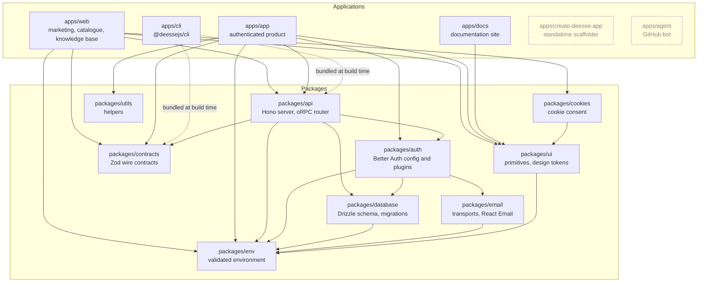

# Workspace architecture and sources of truth

This reference records the current workspace dependency graph and the files that own cross-workspace decisions. Verify it against imports and package exports when those boundaries change.

### How the workspaces depend on each other

Two kinds of arrow. A solid arrow is a runtime import: the workspace imports the package while it runs. A dotted arrow is a build-time dependency: the package is a devDependency that the bundler inlines, so nothing is resolved at run time. The graph is acyclic: `packages/env` and `packages/contracts` sit at the bottom, the applications sit at the top, and nothing points back up.

Reading the graph:

- **`packages/api` is the only package that knows both `packages/auth` and `packages/database`.** It mounts the Better Auth handler and the oRPC router, so it is the place where a request becomes an authenticated database call.
- **`packages/auth` owns the identity rules**, and it reaches the database through `packages/database` and the mailer through `packages/email`. It never imports `packages/api`, which is what keeps the dependency direction clean.
- **`packages/contracts` is a leaf.** It depends on nothing inside the workspace, so it can be imported by the server, the CLI and the web app without creating a cycle.
- **`packages/env` is the foundation.** Five packages depend on it and it depends on none.
- **`apps/cli` carries the registry client inside its bundle.** `packages/api` and `packages/contracts` are devDependencies that tsup inlines, so the published CLI resolves nothing at run time.
- **`apps/create-deesse-app` and `apps/agent` stand alone.** The scaffolder fetches a template by commit and runs no workspace code; the bot is a GitHub webhook handler with no shared runtime.
- **The current `apps/app` to `packages/auth` edge is legacy code, not a pattern to extend. `lib/admin-auth.ts` and the device page call `auth.api.getSession()`, and the sessions table imports branded token helpers from the auth package. These cross the client boundary and are migration targets.
- **Not every link goes through the package manager.** The applications that consume `@workspace/ui` also alias it to the source with a `paths` entry in their `tsconfig.json`. `apps/web` resolves `@workspace/cookies` that way, and that dependency is not declared in its `package.json`. When you add a workspace dependency to an application, declare it in `package.json` too, or the turbo task graph does not know about the edge.

## Where the truth lives

| Question | Read this first |
|---|---|
| How is authentication configured? | `packages/auth/src/auth.ts` |
| Which hosts does the auth handler accept? | `packages/auth/src/host-allowlist.ts` |
| What does the database schema look like? | `packages/database/src/schema/` |
| Where is the API URL prefix defined? | `packages/api/src/constants/base-path.ts` |
| What shape does a template entry have on the wire? | `packages/contracts/src/v1/` |
| Which templates does the registry serve? | `packages/api/src/templates.ts` |
| What are the design tokens? | `packages/ui/src/styles/globals.css` |
| What are the design rules? | `DESIGN.md` |
| What guards the authenticated routes? | `apps/app/proxy.ts` |
| Where do the account settings live? | `apps/app/lib/settings-paths.ts` |
| What are the organization rules? | `packages/auth/src/organization/` |
| What does the agent bot do? | `apps/agent/agent/instructions.md` |
